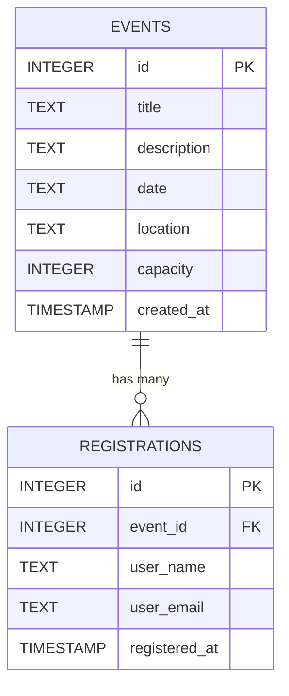

# 🎟️ EventHub - Event Registration System

A full-stack, relational event management and registration web application built using **Python, Flask, and SQLite**. 

Developed as part of the **CodeAlpha Backend Development Internship** (Task 2).

---

## 🌟 Features

- **Relational Data Architecture**: Normalized database schema using Foreign Keys (`FOREIGN KEY (event_id) REFERENCES events(id) ON DELETE CASCADE`) and unique constraints (`UNIQUE(event_id, user_email)`).
- **Interactive Event Browsing**: Real-time listing of upcoming events showing descriptions, dates, venue locations, and dynamically calculated remaining seats.
- **Capacity & Duplicate Prevention**: Server-side validation ensuring users cannot double-book with the same email or exceed venue seating limits.
- **Registration Management**: Allows registered participants to search for their tickets by email and cancel bookings on-demand.
- **RESTful API**: Standardized JSON API endpoints for seamless frontend-backend communication.
- **Modern Dark UI**: Responsive single-page application built with clean HTML5, CSS3, and JavaScript Fetch API.

---

## 🏗️ Relational Database Schema & SQL Queries



### Core SQL Operations:
1. **Dynamic Seat Availability (`LEFT JOIN` & Aggregation)**:
   ```sql
   SELECT e.*, 
          (e.capacity - COUNT(r.id)) AS seats_left,
          COUNT(r.id) AS registered_count
   FROM events e
   LEFT JOIN registrations r ON e.id = r.event_id
   GROUP BY e.id
   ORDER BY e.date ASC;
   ```
2. **User Registrations Lookup (`INNER JOIN`)**:
   ```sql
   SELECT r.id AS reg_id, r.user_name, r.user_email, r.registered_at,
          e.id AS event_id, e.title, e.date, e.location
   FROM registrations r
   JOIN events e ON r.event_id = e.id
   WHERE r.user_email = ?
   ORDER BY r.registered_at DESC;
   ```

---

## 📡 REST API Endpoints

| Method | Endpoint | Description | Status Code |
| :--- | :--- | :--- | :--- |
| `GET` | `/` | Web interface (Dashboard) | `200 OK` |
| `GET` | `/api/events` | List all events with available seats | `200 OK` |
| `GET` | `/api/events/<id>` | Fetch specific event details | `200 OK` / `404` |
| `POST` | `/api/events/<id>/register` | Book a seat for an event | `201 Created` / `400` |
| `GET` | `/api/registrations?email=...` | Query registrations by user email | `200 OK` |
| `DELETE` | `/api/registrations/<id>` | Cancel an existing booking | `200 OK` / `404` |

---

## 🚀 Getting Started

### 1. Prerequisites
- Python 3.8+ installed on your machine.
- Flask library (`pip install flask`).

### 2. Run the Application
1. Open your terminal in the project directory:
   ```powershell
   cd D:\event-registration
   ```
2. Start the Flask server:
   ```powershell
   python app.py
   ```
3. Open your browser and navigate to:
   ```
   http://127.0.0.1:5000
   ```

---

## 📂 Project Structure

```
event-registration/
├── app.py              # Main Flask server and REST API controllers
├── database.py         # SQLite connection, relational schema, and query helpers
├── events.db           # SQLite database file (auto-generated)
├── templates/
│   └── index.html      # Responsive frontend interface
└── .gitignore          # Excludes database and cache files from git tracking
```
